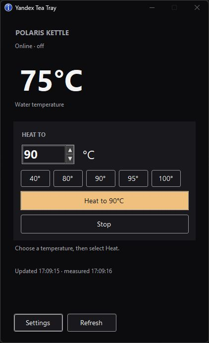

# Yandex Tea Tray

A small Windows app for kettles connected to Yandex Smart Home. It is also a practical C# example of using the Yandex REST API and building a Windows system-tray app with a taskbar widget.




*Live device data shown.*

## Features

- Transparent taskbar temperature display: **Tea: 24°C**; red **No data** status when readings are unavailable or stale.
- Black control panel with temperature presets **40 / 80 / 90 / 95 / 100°C**, custom temperature input, Heat, and Stop.
- Right-click **Heat / Stop** command on both the widget and tray icon, using the selected temperature.
- Draggable widget with automatic width, saved position, and automatic Windows-theme or custom text color.
- Local token encryption using Windows DPAPI. No analytics or extra shell customization software.

The widget is the app’s own window over the main horizontal taskbar; it does not reserve a native taskbar slot or modify Explorer. Move it to a free area if taskbar buttons overlap it. Its display remains visible while Settings is open.

## Connect to Yandex

1. Connect your kettle to **Yandex Smart Home / Alice** first.
2. Register an app in [Yandex OAuth](https://oauth.yandex.com/), requesting `iot:view` and `iot:control`.
3. Set the Redirect URI to `https://oauth.yandex.ru/verification_code` and [obtain an access token](https://yandex.com/dev/id/doc/en/tokens/debug-token). Use the Yandex account linked to your kettle.
4. Run the app, open **Settings**, enter the token, click **Load devices**, select your kettle, and save.

Use the OAuth **access_token**, not the application’s Client ID or Client secret. If an existing token only has `iot:view`, issue a new one after adding `iot:control` to enable controls.

The app uses these endpoints at `https://api.iot.yandex.net`:

| Request | Purpose | Permission |
| --- | --- | --- |
| `GET /v1.0/user/info` | List devices | `iot:view` |
| `GET /v1.0/devices/{id}` | Read device state and capabilities | `iot:view` |
| `POST /v1.0/devices/actions` | Set temperature or stop the kettle | `iot:control` |

Every request uses the header `Authorization: Bearer <access_token>`. For example, in PowerShell:

```powershell
curl.exe "https://api.iot.yandex.net/v1.0/user/info" -H "Authorization: Bearer YOUR_ACCESS_TOKEN"
```

English documentation: [API overview](https://yandex.ru/dev/dialogs/smart-home/doc/en/concepts/platform-protocol), [device state](https://yandex.ru/dev/dialogs/smart-home/doc/en/concepts/platform-device-info), [device actions](https://yandex.ru/dev/dialogs/smart-home/doc/en/concepts/platform-capabilities).

## Build and run

Requires **Windows** and **.NET 10 SDK** to build. Windows 11 provides native dark styling for controls. No third-party NuGet packages are required.

```powershell
dotnet build YandexTeaTray.slnx -c Release
dotnet run --project src/YandexTeaTray -c Release
```

Publish a single Windows x64 executable:

```powershell
dotnet publish src/YandexTeaTray -c Release -r win-x64 --self-contained false -p:PublishSingleFile=true -o artifacts/YandexTeaTray
```

Run `artifacts/YandexTeaTray/YandexTeaTray.exe`. This build needs **.NET 10 Desktop Runtime** on the target computer. Use `--self-contained true` instead to bundle the runtime.

## Use

Click the widget or tray icon to open controls. Choose a temperature and click **Heat**, or use the right-click menu. **Stop** sends power-off. Right-click also provides Settings, widget position reset, and Exit. Closing the control panel keeps the app running.

Launch with `--show-controls` to open the live control panel immediately with a regular taskbar button, useful for screenshots.

Settings lets you change the refresh interval and choose automatic taskbar-theme text color or a custom color. Settings and the encrypted token are stored in `%LOCALAPPDATA%\YandexTeaTray\settings.json`.

Measured water temperature is separate from the selected target. Supported temperatures and reporting behavior depend on the kettle’s Yandex integration. For Polaris, Heat sends the temperature command without an extra generic power-on command, which can reset the program to boiling. A conflicting reported target triggers a stop attempt and an error. Commands are not retried automatically; check device state if execution is uncertain.

Try the UI without a token, network requests, or physical kettle actions:

```powershell
.\artifacts\YandexTeaTray\YandexTeaTray.exe --demo
```

## Tests

```powershell
dotnet run --project tests/YandexTeaTray.Tests -c Release
dotnet run --project tests/YandexTeaTray.Tests -c Release -- --ui-smoke
dotnet run --project tests/YandexTeaTray.Tests -c Release -- --quick-menu-smoke
```

Tests use mock API responses and demo data. They cover command handling, temperature parsing, settings encryption, rendering, and the tray-menu toggle. Physical kettle behavior must be checked separately on the supported device.

## License

[MIT](LICENSE) © 2026 Maxim Tokarev.
